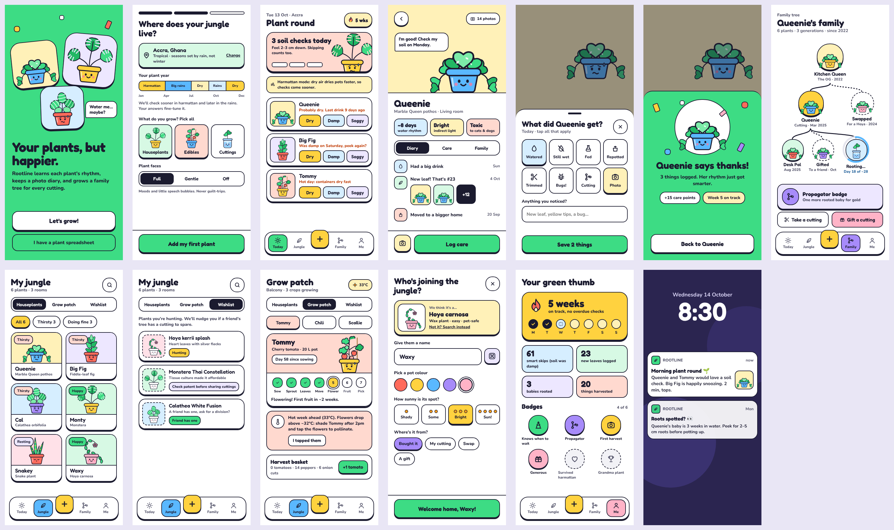

# Rootline 🌱

A playful plant-care app where plants have moods, care is a soil check rather than a schedule, and every cutting keeps its family tree, from houseplants to the tomatoes, peppers and spring onions on your balcony.

## Status

**Phase 1 (research + mockup): done.** The app build is paused pending founder sign-off.

## What's here

| Path | What |
|---|---|
| `docs/product-brief.md` | Vision, positioning, MVP scope, care engine, data stack, risks, open decisions |
| `docs/research/rootline-research-report.md` | Synthesised deep-research report with citations |
| `docs/research/notes/` | Raw research notes: care science, edibles, app market, gamification, data APIs, collector patterns |
| `docs/asset-prompts.md` | Paste-ready ChatGPT prompts for every illustration asset (~89 images) |
| `design/board/` | Source of the interactive design board (`.dc.html` artboards + `canvas.json`) |
| `design/screens/` | Rendered PNG of every screen and state |

Interactive board (clickable prototype): https://claude.ai/artifact/31tneAVDS8aSNWvdv32Dsy

## Core ideas

1. **Reward judgement, not watering.** One-tap Dry / Damp / Soggy soil checks; a smart skip counts as much as a drink.
2. **Seasons from place.** Harmattan and rains in Accra; dormancy in temperate winters.
3. **Moods, never guilt.** Happy, thirsty-but-hopeful, snoozing. Faces can be toned down.
4. **Family trees.** Take or gift a cutting and its lineage travels with it.
5. **Grow patch.** Stage clocks and heat alerts for tomatoes, peppers and spring onions, plus a harvest basket.
