# Glossy enamel badge art

The selected direction is option 1 from the November 2026 comparison: glossy enamel medals with raised three-dimensional details. Production files retain their existing names under `assets/art/`, so the badge map and earned/locked behavior continue to use the same paths.

## Style

- Rounded, beveled rims and a recessed enamel field.
- Raised sculpted motifs, soft reflections and lighting from the upper left.
- The existing badge's motif and colour family, with simple forms readable at the app's 72-pixel display size.
- A near-frontal view with a slight angle that reveals the rim's thickness.
- Transparent square PNGs with clear margins and no external ground shadow.
- Locked versions preserve the corresponding earned design in silver/pewter, with a small dark padlock at the lower right.

There are 16 earned designs and 15 locked designs. The master medal is shown earned only and uses the same image for both map entries. The `10` ribbon remains on Ten skips; the master medal retains its PlantFam ribbon.

## Review and provenance

The first-check badge establishes the approved material and lighting reference. Each other earned design is generated from its existing production illustration plus that reference; each locked design is generated from its new earned counterpart and its previous locked illustration. Original art remains available in Git history and in the incoming source archive where present.

`badge-art-3d-manifest.json` records the delivered files, dimensions, byte sizes and SHA-256 hashes. Generated source exports are kept separately in the execution workspace. The app continues to render PNG artwork; these are rendered 3D illustrations, not mesh assets or animated 3D models.

## Delivery

The 1254 × 1254 generated masters total about 60 MiB and remain in the execution workspace. Production copies are resized to the existing 640 × 640 canvas and encoded as optimized transparent PNGs. The complete production set is about 4.50 MiB, compared with about 2.15 MiB for the previous artwork. The manifest includes each master's hash as well as its delivery file's hash.

[Open the badge gallery](badge-art-3d-gallery.html) to review enlarged and 72-pixel examples on light and dark backgrounds. The main asset gallery and inventory also reflect the replacement badge files.

## Badge preview

| Badge | Earned | Locked |
| --- | --- | --- |
| First Check |  |  |
| First Cutting | 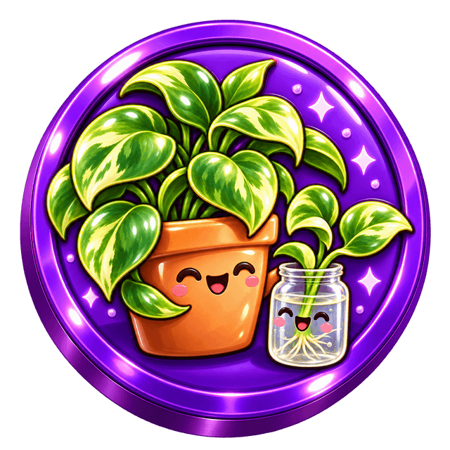 |  |
| First Harvest | 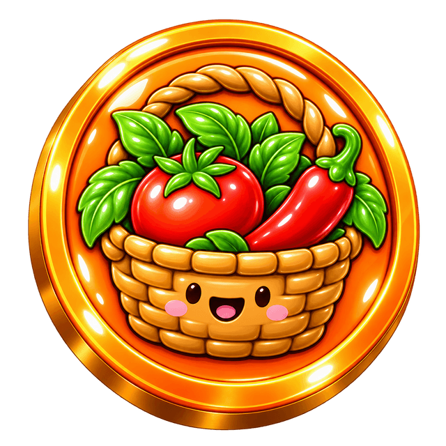 | 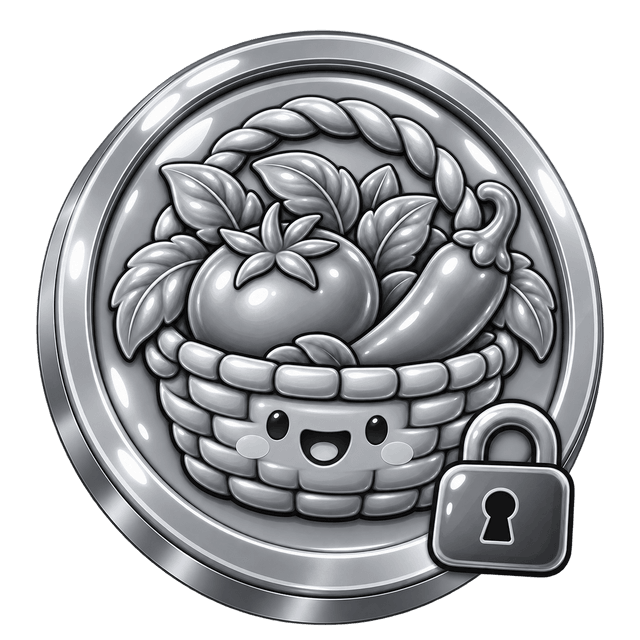 |
| First Photo | 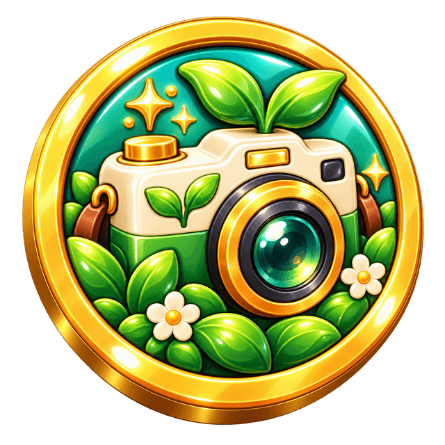 |  |
| First Roots | 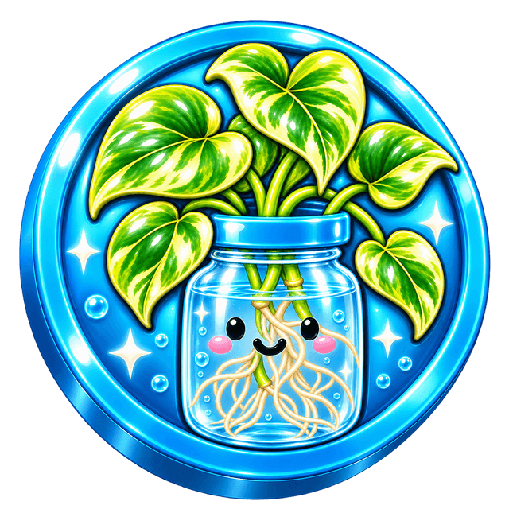 |  |
| First Skip | 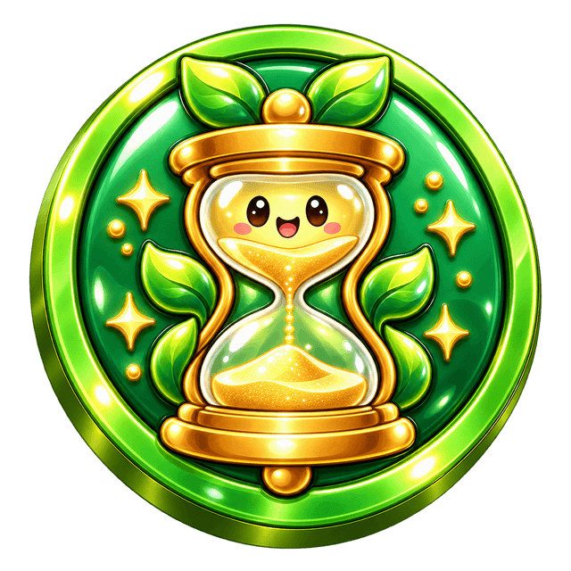 | 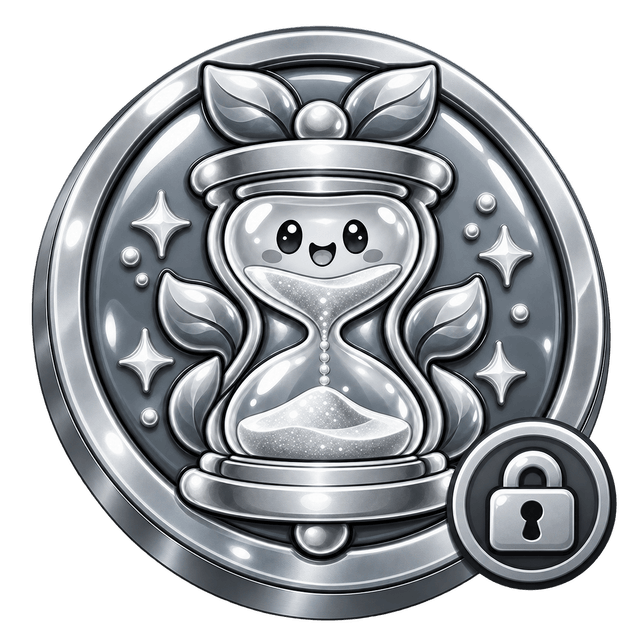 |
| Five Plant Fam | 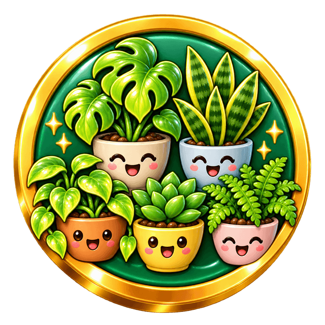 | 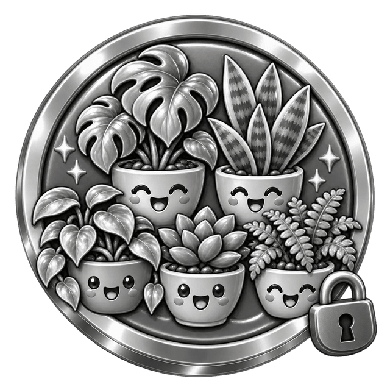 |
| Four Week Streak | 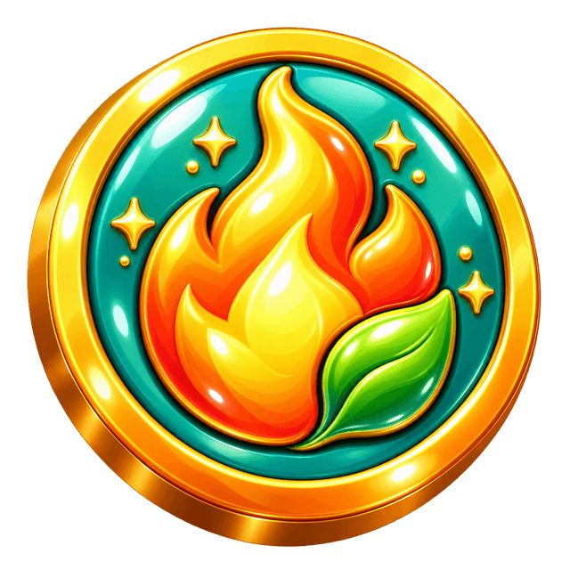 |  |
| Generous | 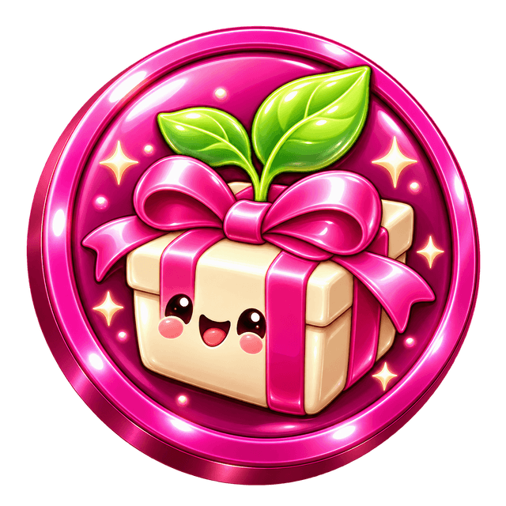 |  |
| Grandma Plant |  |  |
| Medal |  | Earned only |
| Propagator | 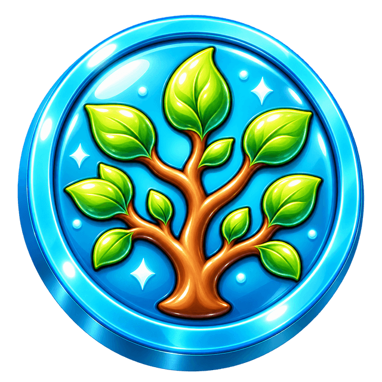 |  |
| Survived Dry Season | 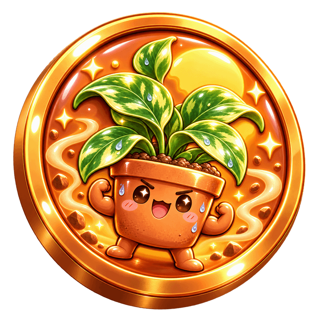 |  |
| Survived Grey Season | 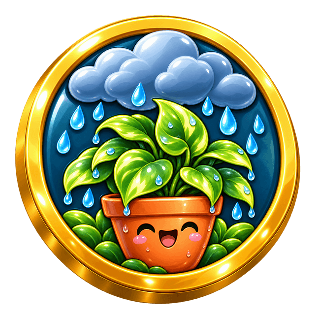 |  |
| Survived Winter | 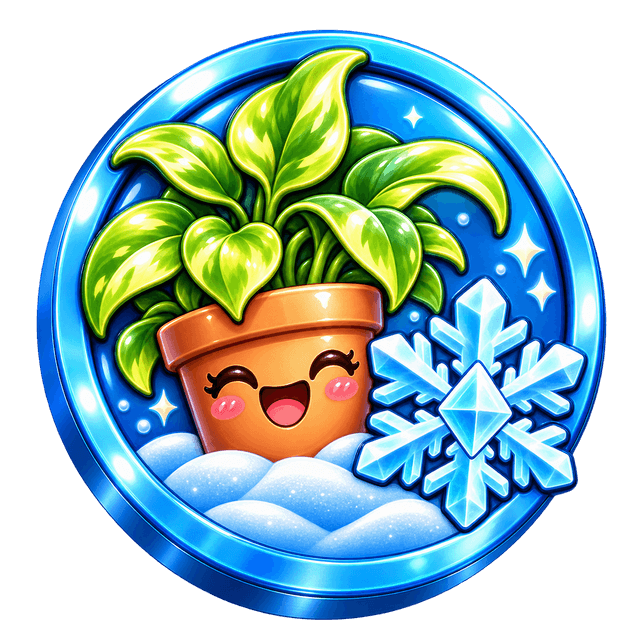 |  |
| Ten Skips | 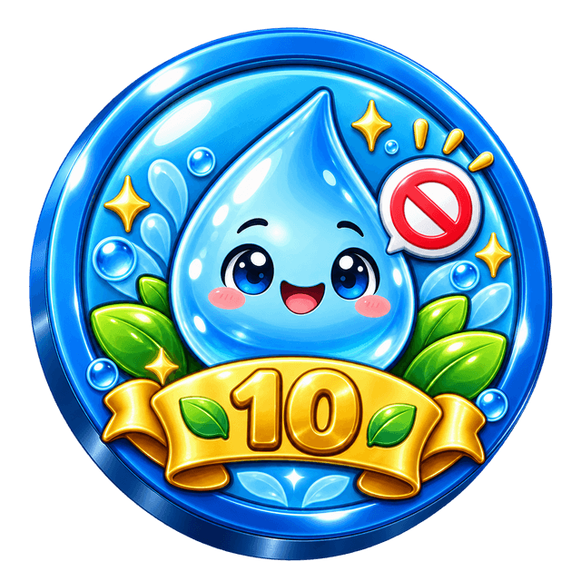 | 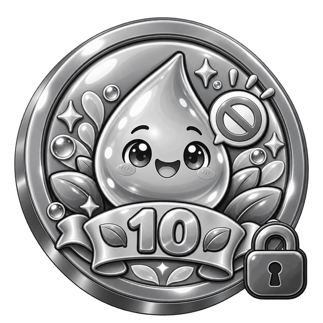 |
